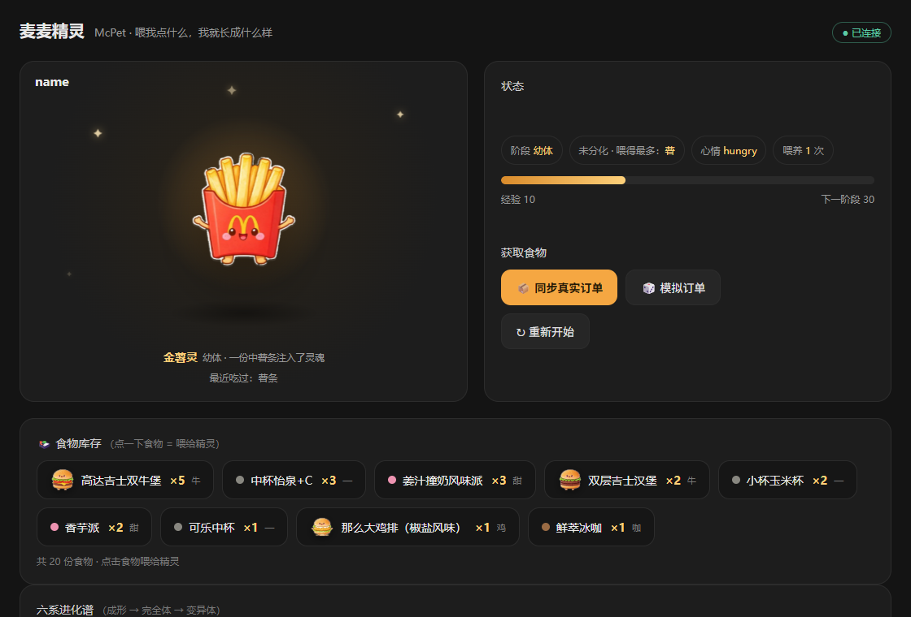
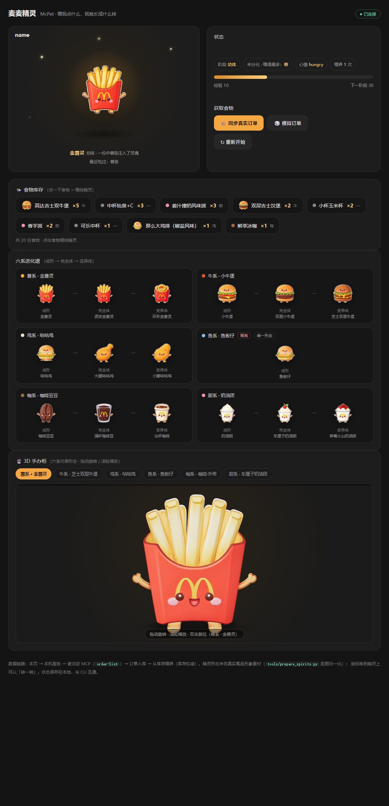
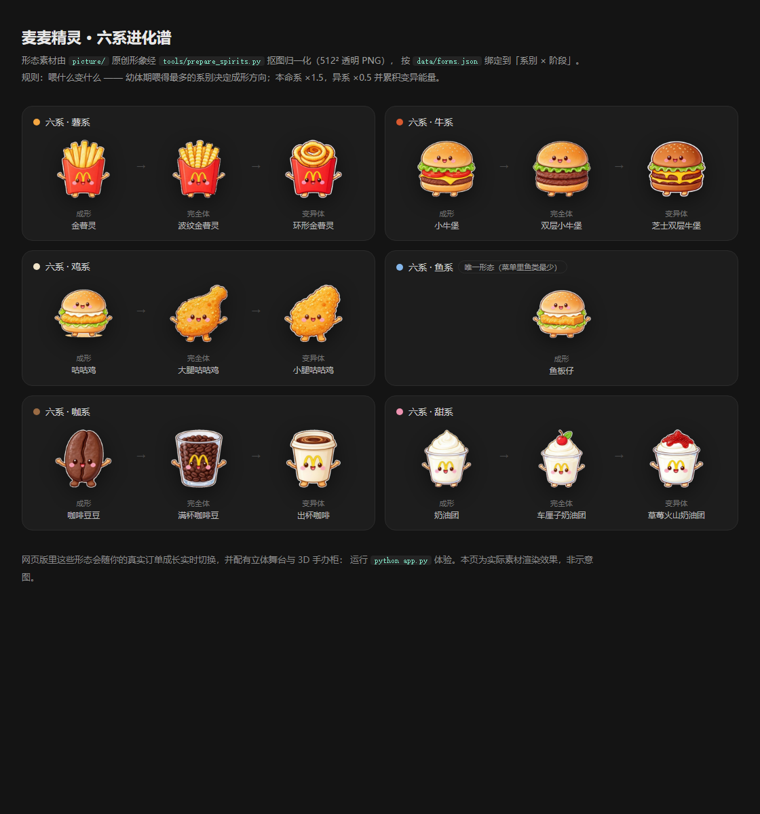
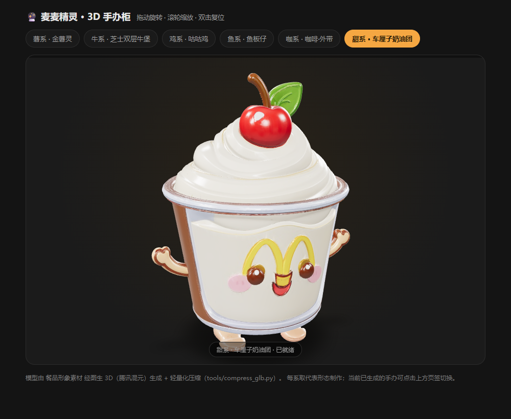

# 麦麦精灵 McPet 🍟

> **喂我点什么，我就长成什么样。**



一个基于麦当劳官方 MCP 的**养成系 Skill**：领养一只麦麦精灵，它吃你**真实的麦当劳订单**长大。喂薯条多，它长成薯系；喂牛肉堡多，它长成牛系；喂得越杂，越可能喂出稀有的**变异体**。

> **🎮 在线试玩（零安装，打开即玩）**：**https://wujunwei2003.github.io/McDonald-pet/**
> 无需安装任何环境——浏览器里直接孵化、喂养、看它进化（模拟订单模式）。

## 目标用户

- **麦当劳常客**：给日常点单加点乐趣——你的点单习惯，就是精灵的基因
- **养成 / 收集玩家**：喜欢电子宠物、精灵收集、开图鉴的玩家
- **爱晒的人**：需要"一看就想分享"的社交素材——"我把精灵喂成变异体了"
- **MCP 开发者**：想参考"个人数据接口 → 游戏化玩法"完整实现的开发者

## 为什么好玩

- **喂什么变什么**：幼体期你喂得最多的系别，决定它的成形方向 —— 你的真实点单习惯就是它的基因
- **本命加成**：喂对口食物，成长 ×1.5；喂"错"了也不是浪费——异系能量攒满会触发**稀有变异体**
- **🎨 异色染色**：喂异系食物会让它的**颜色慢慢变化**——汉堡精灵被咖啡喂多了，面包会逐渐发灰变黑；咖啡精灵喂浅色食物会越变越淡（奶咖 → 雪碧色 → 怡泉黄）；连喂本命系还能把颜色「洗」回来
- **六系谱系 × 三阶进化**：薯 / 牛 / 鸡 / 鱼（稀有）/ 咖 / 甜，每系有「成形 → 完全体 → 变异体」三段形态
- **真实餐品形象**：精灵形态来自一套餐品形象素材（薯条灵、汉堡灵、咖啡灵……），统一抠图归一化后按系别/阶段绑定
- **🔮 3D 手办柜**：六系代表形态经图生 3D 制作成立体手办，可在网页里拖动旋转、滚轮缩放

## 快速开始

### 在线试玩（推荐先试）

打开 **https://wujunwei2003.github.io/McDonald-pet/** —— 零安装，浏览器里直接孵化/喂养/看进化（模拟订单模式）。

**想用你自己的真实订单喂？** 试玩页是纯静态页面（出于安全无法直连麦当劳服务器），两步即可：

```bash
python mcpet.py export     # 拉取你账号的历史订单 → mcpet-orders.json（也可用独立脚本：docs/demo/export_orders.py）
```

然后在试玩页点「📥 导入账号数据」上传该文件（或直接粘贴内容）——门店版订单记录与食物库存即刻到账（数据只存浏览器本地，重复导入自动去重）。

### 网页版（完整版，本机运行）

```bash
python app.py          # 自动打开浏览器 http://127.0.0.1:8765
```

> 数据链路：网页 → 本机服务（规避浏览器 CORS）→ 麦当劳 MCP。
> 页面包含：立体精灵舞台（鼠标可"转一转"）、食物库存（点一下 = 喂一口）、
> 六系进化谱、3D 手办柜。状态与 CLI 共用同一份文件，两边数据互通。

### 命令行版

```bash
# 孵化一颗蛋
python mcpet.py hatch --name 小薯

# 喂养（三种来源：real 真食 / daily 每日投喂 / event 活动）
python mcpet.py feed "巨无霸"
python mcpet.py feed "薯条" --source daily

# 查看状态
python mcpet.py status

# 导出精灵形象（SVG 兜底形态）
python mcpet.py show --out spirit.svg

# 模拟订单干跑预览（内置样本，含套餐拆解）
python mcpet.py simulate
python mcpet.py simulate --apply        # 实际喂养

# 真实订单同步（需要 MCP Token；默认只预览不落库）
export MCD_MCP_TOKEN=你的token
python mcpet.py sync                    # 干跑预览：看看会变成什么
python mcpet.py sync --apply            # 实际喂养
```

**套餐怎么算？** 订单里的套餐（随心配 / 三件套等）会**自动拆解成子项**分别喂养：
随心配（双牛堡＋汽水）= 喂牛系一次 + 汽水"无感"；三件套（汉堡＋薯条＋可乐）= 喂鸡系一次 + 喂薯系一次 + 可乐"无感"。
数据来自订单接口自带的 `comboItemList` 子项，无需额外查询。

**库存制**：同步订单 → 食物入库（按订单号去重）→ 点击食物喂养（库存扣减）。
状态与网页、CLI 三方互通。运行网页版与 CLI 仅需 Python 3.10+（零第三方依赖）。

### WorkBuddy Skill（对话式体验）

本项目自带 WorkBuddy Skill 封装（[`skill/SKILL.md`](skill/SKILL.md)）。安装后可在 WorkBuddy 对话中直接养精灵：

```bash
# 安装：把 skill 目录复制到 WorkBuddy 技能目录
cp -r skill ~/.workbuddy/skills/mcpet
# （Skill 会通过 MCPET_HOME 环境变量或询问你来找项目目录）
```

之后直接说人话：

> "帮我孵一只麦麦精灵" → 孵化
> "同步我的麦当劳订单喂精灵" → 先预览、确认后再喂
> "我的精灵现在怎么样了" → 状态与形态播报

## 界面预览

**主界面**：精灵舞台（鼠标可"转一转"）+ 食物库存（点一下 = 喂一口）+ 六系进化谱 + 3D 手办柜



**六系进化谱**（喂什么变什么：六系 × 成形 → 完全体 → 变异体）



**3D 手办柜**（图生 3D 制作，网页内拖动旋转 / 滚轮缩放）



## 成长规则

| 阶段 | 条件 | 说明 |
|------|------|------|
| 幼体 | 默认 | 未分化，显示"倾向系别"的小号基础形态 |
| 成形 | 经验 ≥ 30 | 按喂得最多的系别定系（形态：T2 基础） |
| 完全体 | 经验 ≥ 80 | 该系进阶形态（T3） |
| 变异体 | 异系值 ≥ 20 | 稀有形态（T4），成形后持续喂异系食物触发 |

喂养倍率：真食 ×1.0 ｜ 每日投喂 ×0.3 ｜ 活动 ×1.2
相性倍率：本命系 ×1.5 ｜ 异系 ×0.5（同时累积异系值）

### 六系进化谱

| 系别 | 成形（T2） | 完全体（T3） | 变异体（T4） |
|------|-----------|-------------|-------------|
| 薯 | 金薯灵 | 波纹金薯灵 | 环形金薯灵 |
| 牛 | 小牛堡 | 双层小牛堡 | 芝士双层牛堡 |
| 鸡 | 咕咕鸡 | 大腿咕咕鸡 | 小腿咕咕鸡 |
| 鱼 | 鱼板仔（菜单里鱼类最少 → **唯一形态**，稀有） | 同左 | 同左 |
| 咖 | 咖啡豆豆 | 满杯咖啡豆 | 出杯咖啡 |
| 甜 | 奶油团 | 车厘子奶油团 | 草莓火山奶油团 |

## 项目结构

```
mcpet/
├── README.md                # 项目介绍 / 安装 / 使用示例 / 目标用户
├── CONTEST_DECLARATION.md   # 参赛声明（官方原版）
├── MCP_INTEGRATION.md       # MCP 接入说明（Server / Tool / 调用流程 / 业务价值）
├── mcp-config.example.json  # 脱敏配置示例（仅环境变量占位符）
├── workbuddy.md             # WorkBuddy 开发上下文（专项奖励）
├── LICENSE                  # MIT
├── index.html               # GitHub Pages 入口（跳转到在线试玩页）
├── docs/
│   ├── demo/                # 🎮 在线试玩页（静态版，零安装打开即玩）
│   │   ├── index.html       #   试玩页主体（含「导入账号数据」）
│   │   ├── dye.js           #   异色染色引擎（浏览器 + Node 两用）
│   │   ├── import.js        #   账号数据导入解析器（三种格式，含测试）
│   │   ├── export_orders.py #   独立导出脚本（单文件零依赖，给试玩者用）
│   │   ├── sample-orders.json  # 示例导入文件
│   │   └── assets/spirits/  #   试玩页专用 WebP 素材（512 + 128 缩略图）
│   └── screenshots/         # 界面截图
├── skill/
│   └── SKILL.md             # WorkBuddy Skill 封装（对话式养精灵）
├── app.py                   # 网页版入口（本地服务 + MCP 转发 + 静态资源）
├── web/
│   └── index.html           # 网页界面（零框架单页，含立体舞台与 3D 手办柜）
├── mcpet.py                 # CLI 入口（孵化/同步/导出/喂养/状态/形象）
├── src/
│   ├── spirit_gen.py        # 参数化 SVG 生成器（兜底形态，零素材可用）
│   ├── feeding.py           # 喂养引擎（纯逻辑，可测试）
│   ├── pantry.py            # 食物库存（订单入库/去重/模糊匹配）
│   ├── order_parser.py      # 订单结构化解析（含套餐拆解）
│   ├── state.py             # 本地状态持久化
│   └── mcp_client.py        # 麦当劳 MCP 客户端（stdlib-only）
├── data/
│   ├── lineage.json         # 六系配置与餐品关键词映射
│   ├── forms.json           # 形态表（系别 × 阶段 → 形象素材）+ 食物图标映射
│   └── sim_orders.json      # 模拟订单样本
├── assets/
│   ├── spirits/             # 精灵形态素材（512² 透明 PNG ×21，构建产物）
│   └── 3d/                  # 3D 手办（GLB ×6）+ model-viewer + viewer.html
├── tools/                   # 构建期工具（需要 Pillow，不影响运行时零依赖）
│   ├── prepare_spirits.py   # 抠图 → 透明 PNG → 归一化 512²（含 QA 对照图）
│   ├── gen3d.py             # 图生 3D（直调云端，进程内传图绕过命令行长度限制）
│   ├── compress_glb.py      # GLB 轻量化（贴图降采样 + JPEG，37MB → 5MB）
│   ├── make_demo_assets.py  # 试玩页素材优化（PNG → WebP + 缩略图，5.1MB → 0.85MB）
│   └── test_dye.mjs / test_import.mjs  # 染色与导入逻辑测试（Node，26 项）
└── tests/                   # 单元测试（35 项：养成 14 + 订单 9 + 库存 7 + 形态 5）
```

## 使用到的麦当劳 MCP 工具

| 工具 | 用途 | 状态 |
|------|------|------|
| `order-list` | 真实订单 → 食物库存数据源 | 已集成 |
| `query-meals` | 今日菜单 → 餐品图 / 每日投喂 | 已集成 |
| `query-my-account` | 积分余额（孵化资格参考） | 已集成 |
| `available-coupons` | 可用优惠券 | 已集成 |
| `campaign-calendar` | 活动日 → 限定投喂 | 规划中 |
| `list-nutrition-foods` | 餐品营养 → 精灵体质面板 | 规划中 |

> 详见 [MCP_INTEGRATION.md](MCP_INTEGRATION.md)。

## 开发状态

- [x] 喂养引擎（分类/倍率/晋升/变异）+ 订单解析 + 库存系统（35 项测试全绿）
- [x] CLI 完整闭环（孵化 → 同步 → 喂养 → 状态 → 出图）
- [x] 网页版（立体精灵舞台 / 库存卡片 / 六系进化谱 / 真实订单同步）
- [x] 形态素材管线（21 张 → 抠图归一化 → 形态表绑定 + 食物图标）
- [x] 3D 手办柜（图生 3D + GLB 压缩 + 网页内旋转查看；六系 ×1 全部上线）
- [x] WorkBuddy Skill 封装（对话式养精灵）
- [x] 参赛材料（CONTEST_DECLARATION / MCP_INTEGRATION / mcp-config.example / workbuddy.md）

## 安全与合规

- 仓库**不含任何真实凭证**：Token 通过环境变量 `MCD_MCP_TOKEN` 或本地 `.mcpet.token` 注入（已 gitignore）
- 配置示例见 [`mcp-config.example.json`](mcp-config.example.json)，仅使用环境变量占位符
- 精灵形象素材与 3D 模型为项目原创素材，仅在本项目内使用（见 [LICENSE](LICENSE)）

---

*本项目为「麦当劳程序员创意开发大赛」参赛作品，基于麦当劳中国官方 MCP（mcp.mcd.cn）开发。
参赛材料：[CONTEST_DECLARATION.md](CONTEST_DECLARATION.md) · [MCP_INTEGRATION.md](MCP_INTEGRATION.md) · [mcp-config.example.json](mcp-config.example.json) · [workbuddy.md](workbuddy.md)。
精灵形象素材为原创绘制素材，仅用于本参赛项目。*
